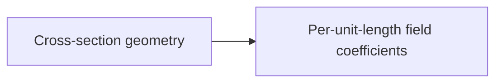
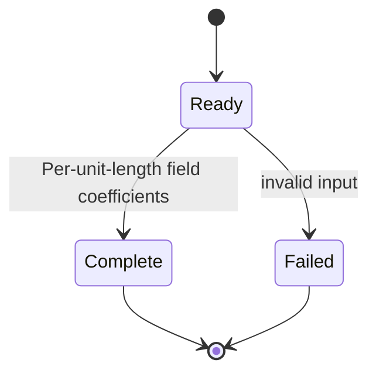

## What is it?

Signal-integrity tools for tscircuit boards.

## How to use it?

The stack retains Circuit JSON validation, physical stackup and stimulus helpers, IBIS asset loading and the ngspice adapter.
Reads the PCB transient channel simulation records that core writes from TSX, and checks each channel's endpoint pins, IBIS models, timing and PRBS pattern before simulating.
RoutedAdmissionSolver lowers each declared block into immutable inputs for route sections and buffer binding.
RouteSectionsSolver divides scoped copper into straight slices and resolves physical endpoint contacts.
The standalone 2D cross-section solve returns per-unit-length C/C0/L and frequency-dependent R/G.

## General workflow

