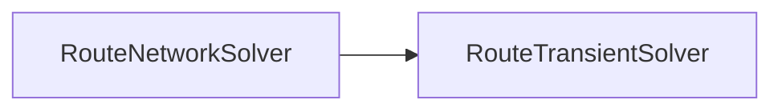
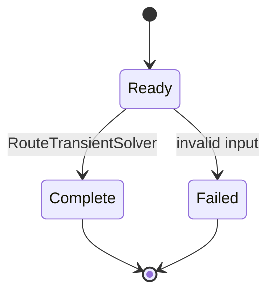

## What is it?

Signal-integrity tools for tscircuit boards.

## How to use it?

The stack retains Circuit JSON validation, physical stackup and stimulus helpers, IBIS asset loading and the ngspice adapter.
Reads the PCB transient channel simulation records that core writes from TSX, and checks each channel's endpoint pins, IBIS models, timing and PRBS pattern before simulating.
RoutedAdmissionSolver lowers each declared block into immutable inputs for route sections and buffer binding.
RouteSectionsSolver divides scoped copper into straight slices and resolves physical endpoint contacts.
The standalone 2D cross-section solve returns per-unit-length C/C0/L and frequency-dependent R/G.
RouteFieldsSolver screens nearby conductor pairs and extracts coupled coefficients for each unique section.
IBIS conversion resolves scalar or coupled package elements and validates selected package matrices during admission.
RouteBindingsSolver associates compiled buffers, sources and probes with the allocated circuit node map.
RouteNetworkSolver integrates route energies into a coupled ladder with via and oblique corrections and emits a deck.
RouteTransientSolver invokes ngspice through the injected solver port and publishes complete raw-vector captures.

## General workflow

