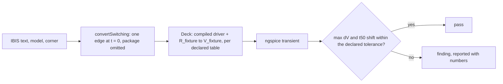

# IBIS fixture check

The vendor's `[Rising Waveform]` and `[Falling Waveform]` tables give the buffer's V(t) into a declared
fixture. The pipeline turns those tables into switching weights Ku(t), Kd(t) that scale the
`[Pullup]`/`[Pulldown]` currents (`src/buffers/switching.ts` over the pinned `@tscircuit/ibis-to-spice`
`switchingWeights`, see [ibis-switching.md](ibis-switching.md)). If the compiled driver, its C_comp, its
clamps and its weights are right, the compiled driver alone in that same fixture must reproduce the table.
This check runs that replay for every declared fixture, edge and corner.

The harness is `tests/support/ibis-fixture.ts` (`replayFixtures`, `receiverCurrent`). The checks are in
`tests/buffers/switching.test.tsx`.

## What the IBIS specification says about the fixture

[IBIS 7.2, §6.1, `[Rising Waveform]`/`[Falling Waveform]`, printed pp. 105–106](https://ibis.org/ver7.2/ver7_2.pdf#page=105):

- “These voltage versus time points are taken under the conditions specified by the R/L/C/V_fixture and
  R/L/C_dut subparameters.”
- “The R_dut, C_dut, and L_dut subparameters are analogous to the package parameters R_pkg, C_pkg, and
  L_pkg and are used if the waveform includes the effects of pin inductance/capacitance.” And: “If a
  subparameter is not used, its value defaults to zero.”
- “The data in the waveform table is measured with the effects of the C_comp parameter included.”
- “V_fixture defines the voltage for typ, min, and max supply conditions. However, when the fixture voltage
  is related to the power supply voltages, then the subparameters V_fixture_min and V_fixture_max can be
  used to further specify the fixture voltage for min and max supply voltages.”
- “All waveform extractions should reference a common input stimulus time”; “The first line in each
  waveform table should be assumed to be the reference point in time corresponding to a logic transition.”

So the tables are taken at the die pad, with C_comp, and with **no** package unless R/L/C_dut say so.
The harness therefore compiles with `packagePolicy: 'omit'` (no `[Package]` or `[Pin]` R/L/C), drives the
fixture directly from the die pad, uses V_fixture_min/max at those corners, and starts the edge at table
time 0. Nonzero R/L/C_dut, C_fixture or L_fixture are rejected by the pinned parser (`unsupported_fixture`),
so a model with them cannot reach this harness silently. In the vendor files below they are all absent.

## Tolerance, declared before any run

| Quantity | Limit | Why |
|---|---|---|
| max \|V_sim − V_table\| over the table's own time points | ≤ 2% of the table swing | ≈ 15 mV on the 0.75 V swing of a 50 Ω DDR3 fixture, an order below the 175 mV VIH(ac) − VREF margin (JESD79-3F §9). Numerical error sources are the 3-point derivative used for C_comp·dV/dt, linear table interpolation and ngspice `reltol=1e-4`; each is well under 1%. |
| 50% crossing shift | ≤ max(10 ps, 1% of the table's 20–80% edge time) | 10 ps is 0.8% of the 1.25 ns UI at 800 Mb/s. The 1% term only matters for edges slower than 1 ns. The 20–80% definition is the IBIS `[Ramp]` one (§6.1). |
| Receiver DC pad current over −0.5 V..V_supply + 0.5 V | ≤ 1% of the largest table current | Receivers (`CMD`, `ODT_60`) have no waveform tables; the compiled clamp sources are the tables themselves, so only solver error remains. A sign or reference error is a 100% error. The 0.5 V margin covers the DDR3 0.4 V AC overshoot/undershoot limit (JESD79-3F §9). |

These limits are not loosened for any model. A failure is reported below with its numbers.

Amendment, made before the receiver results below: the receiver sweep was first declared over 0..V_supply.
`CMD` has no ODT, so its clamps carry no current inside the rails, and that first run gave no number
(0/0). The sweep was widened to 0.5 V beyond each rail for every receiver before re-running. The
`ODT_60` error under the original range was 0.003% at every corner.

## Synthetic known answer (committed, runs wherever ngspice is on PATH)

`tests/buffers/switching.test.tsx` writes a small IBIS file. Its driver has linear pullup and pulldown
(R0 each), C_comp, and weights Ku = s(t), Kd = 1 − s(t) with s a linear ramp after a lead-in. Then the pad
obeys C·dV/dt = s·V_dd/R0 − V/R0 + (V_f − V)/R, a first-order system driven by a ramp, whose solution is
closed form. The tables are that solution, sampled every 10 ps, for three fixtures per edge: 50 Ω to 0 V,
50 Ω to V_dd (with V_fixture_min/max), and 100 Ω to V_dd/2. The converter fits its weights from the first
two only, so the third is an out-of-sample load. All three corners differ (V_dd, R0, C_comp, ramp time).
A receiver model with 120 Ω clamps to each rail has a closed-form 60 Ω Thevenin termination.

The same test fits the weights from a document with C_comp set to zero, while the compiled netlist keeps
C_comp. That is the bug class “C_comp current left out of weight extraction”, which IBIS rules out (“All
tables assume that the die capacitance is included”). The check must fail on it.

## Results

Measured results are filled in below after the runs.
